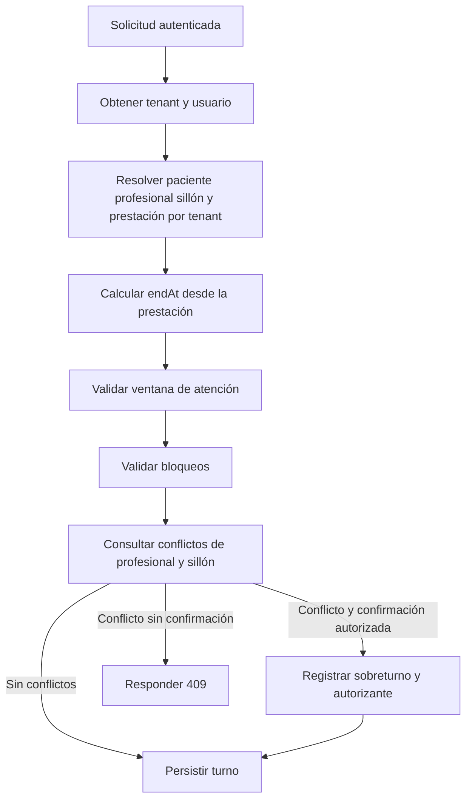

# Design

## Context

Ver `proposal.md` para la motivación. El backend usa Spring Boot 3, JPA, H2, Flyway y Spring Security. Las entidades y tablas principales de agenda ya existen; los repositorios solo ofrecen búsquedas básicas por tenant. El JWT coloca el `tenantId` en `TenantContext` y el identificador del usuario autenticado en el principal de Spring Security.

Las reglas aplicables son RN-AG-01 a RN-AG-08. Todas las consultas y referencias deben limitarse al tenant autenticado, y la API debe utilizar DTOs separados de las entidades JPA.

## Goals / Non-Goals

**Goals:**

- Exponer una API REST interna y multi-tenant para recursos de agenda y turnos.
- Concentrar las reglas de disponibilidad en una capa de aplicación transaccional.
- Hacer verificables los límites temporales, permisos, bloqueos y sobreturnos.
- Conservar evidencia del usuario que autoriza un sobreturno.
- Devolver errores HTTP consistentes sin revelar recursos de otra clínica.

**Non-Goals:**

- Implementar componentes frontend o mockups.
- Crear la ruta pública de reserva.
- Aplicar políticas de cancelación o reprogramación de C-06.
- Enviar notificaciones o procesar pagos.
- Cambiar el mecanismo de autenticación creado en C-03.

## Decisions

### 1. API REST separada por recurso

Se expondrán `/api/professionals`, `/api/chairs`, `/api/services`, `/api/blocks` y `/api/appointments`. Los controladores recibirán y devolverán records DTO, delegarán en servicios y no expondrán entidades JPA.

**Alternativa considerada:** un único controlador `/api/agenda`. Se descarta porque mezcla ciclos de vida y permisos distintos, dificulta la evolución de C-05 y C-07 y produce contratos poco específicos.

### 2. Tenant derivado del contexto autenticado

Los servicios obtendrán el tenant desde `TenantContext`; ningún DTO aceptará `tenantId`. Toda resolución de identificadores utilizará `findByIdAndTenantId`, y las consultas de disponibilidad incluirán `tenant_id` como primer filtro.

**Alternativa considerada:** recibir el tenant como parámetro o cabecera. Se descarta porque permitiría suplantación y contradice el contrato de C-03.

### 3. Horario semanal tipado sobre la columna JSON existente

La API representará el horario como un mapa de día ISO (`MONDAY` a `SUNDAY`) a una lista de ventanas `{start: "HH:mm", end: "HH:mm"}`. Un componente convertirá entre ese DTO y el texto JSON existente en `Professional.schedule`, normalizando el orden y rechazando ventanas inválidas o superpuestas. Las horas se interpretarán usando `Clinic.timezone`.

**Alternativa considerada:** crear una tabla de ventanas horarias. Sería mejor para consultas avanzadas, pero amplía el modelo y la migración sin necesidad para el MVP; la columna existente fue creada para este contrato.

### 4. Intervalos semiabiertos y consultas de solapamiento

Todos los intervalos se tratarán como `[inicio, fin)`. Hay solapamiento cuando `existente.startAt < solicitado.endAt` y `existente.endAt > solicitado.startAt`. Las consultas de `AppointmentRepository` excluirán `cancelled`, filtrarán por tenant y permitirán excluir el turno actual durante una actualización. `BlockRepository` aplicará la misma fórmula.

**Alternativa considerada:** comparar intervalos en memoria. Se descarta porque puede omitir registros, crea condiciones de carrera más amplias y no escala con la agenda.

### 5. Servicio transaccional de programación

`AppointmentService` resolverá las referencias por tenant, verificará recursos activos, calculará `endAt`, validará horario y bloqueos, consultará conflictos y persistirá dentro de una transacción. Una actualización que cambie datos temporales repetirá el mismo flujo.

### 6. Sobreturno explícito y auditable

La solicitud podrá incluir `allowOverbooking`, que por defecto será `false`. Si existen conflictos con otros turnos, solo `admin`, `receptionist` o el profesional dueño de esa agenda podrán continuar con valor `true`. Una migración V005 añadirá `overbooked BOOLEAN NOT NULL DEFAULT FALSE` y `overbook_authorized_by_user_id BIGINT NULL` a `appointments`.

La excepción no omitirá horarios, bloqueos, recursos inactivos ni aislamiento por tenant.

**Alternativa considerada:** aceptar un parámetro sin persistirlo. Se descarta porque la consigna exige trazabilidad y no permitiría explicar por qué se aceptó una colisión.

### 7. Autorización declarativa y verificación de propiedad

Se utilizará `@PreAuthorize` para la matriz general: configuración de profesionales/sillones/prestaciones solo para `admin`; lectura para `admin`, `receptionist` y `professional`; administración de turnos para `admin` y `receptionist`; operaciones profesionales condicionadas a que el turno o bloqueo sea propio. La comprobación de propiedad se realizará en el servicio porque depende de datos persistidos.

### 8. Errores de dominio consistentes

Un `@RestControllerAdvice` mapeará: recurso no encontrado a 404, rol insuficiente a 403, validación de negocio a 422 y conflicto de disponibilidad a 409. Las respuestas incluirán un código estable y un mensaje sin datos clínicos ni personales.

### 9. Eliminación y frontera con C-06

Los recursos configurables podrán eliminarse solo cuando no estén referenciados; en caso contrario se desactivarán mediante actualización. Un `admin` podrá eliminar un turno creado por error. La cancelación operativa, reprogramación y política de anticipación permanecen en C-06 y usarán estados en lugar de eliminación física.

## API prevista

| Recurso | Operaciones | Roles de escritura |
|---|---|---|
| `/api/professionals` | POST, GET, GET por id, PUT, DELETE | admin |
| `/api/chairs` | POST, GET, GET por id, PUT, DELETE | admin |
| `/api/services` | POST, GET, GET por id, PUT, DELETE | admin |
| `/api/blocks` | POST, GET, GET por id, PUT, DELETE | admin, receptionist; professional solo propio |
| `/api/appointments` | POST, GET, GET por id, PUT, PATCH estado, DELETE | admin, receptionist; professional solo propio y sin eliminación |

## Risks / Trade-offs

- **Condición de carrera entre validación y escritura** → ejecutar la programación transaccionalmente y añadir índices para las búsquedas; documentar que el bloqueo pesimista o una restricción específica de otra base puede ser necesario al migrar desde H2.
- **JSON de horario difícil de consultar** → centralizar serialización y validación en un único componente; una tabla normalizada puede reemplazarlo en una migración futura.
- **Eliminación administrativa de turnos reduce trazabilidad** → limitarla a `admin` y reservar la cancelación normal para C-06; si el equipo exige auditoría completa, reemplazarla por un estado técnico antes de Apply.
- **Zona horaria con `LocalDateTime`** → interpretar todas las fechas mediante la zona de la clínica y no mezclar zonas en la API de este change.
- **Mensajes de conflicto pueden filtrar información** → informar tipo de recurso en conflicto sin devolver datos del turno existente.

## Migration Plan

1. Crear V005 con las columnas de auditoría de sobreturno y los índices multi-tenant usados por las consultas de disponibilidad.
2. Implementar DTOs, validadores, repositorios y servicios sin alterar las migraciones anteriores.
3. Exponer controladores y autorización por rol.
4. Ejecutar los tests del contrato aprobado antes de habilitar los endpoints para otros changes.
5. Para rollback, retirar los endpoints y servicios; las columnas nuevas pueden permanecer sin uso para evitar una migración destructiva.

## UI Mockups

- Decision: no (no UI)
- Reason: C-04 implementa exclusivamente API y lógica backend; la interfaz pertenece a C-07.

## Open Questions

Ninguna que pueda cambiar el contrato o el desglose de tareas antes de Apply. La política de auditoría para eliminaciones administrativas queda señalada como riesgo para la revisión humana de Propose.
